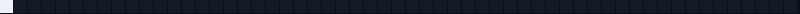

<p align="center">
  
</p>

<p align="center">
  
</p>

### `sobre_mim.dart`

```dart
// Belém, PA · Estácio Belém · Engenharia da Computação

class Diego {
  final foco = [
    'apps com Flutter e Dart',
    'integrações com APIs REST (Azure)',
    'jogos em Godot e Unity',
  ];

  final estudando = [
    'computação quântica (Qiskit)',
    'segurança',
  ];

  void main() {
    aprender();
    construir();
    anotarOQueAprendi();
  }
}
```

<p align="center">
  
</p>

### `projetos.yaml`

| Projeto | O que é | Stack |
|---|---|---|
| **[wfc-bench](https://github.com/Dio-zic/wfc-bench)** | Compara geração procedural de mapas (Wave Function Collapse) clássica e quântica, em simulador. O mapa do topo desta página usa o mesmo tileset do projeto. | `Python` `Qiskit` |
| **[qkd-qrng](https://github.com/Dio-zic/qkd-qrng)** | Simulações do protocolo BB84 (distribuição quântica de chaves) e de um gerador quântico de números aleatórios. | `Python` `Qiskit` |

<sub>Os dois projetos são estudos em andamento, executados em simulador (sem hardware quântico real).</sub>

<p align="center">
  
</p>

### `stack.json`

<p align="center">
  
  
  
  
  
  
  
  
</p>

<sub>Edite esta lista: deixe só o que você usa de verdade. Se o seu back-end é C#, acrescente: `https://img.shields.io/badge/C%23-0A0E16?style=flat-square&logo=csharp&logoColor=78C8BE`.</sub>

### `contato.md`

<p align="center">
  <a href="https://www.linkedin.com/in/diego-pereira-38baab365"></a>
</p>

<p align="center">
  
</p>
