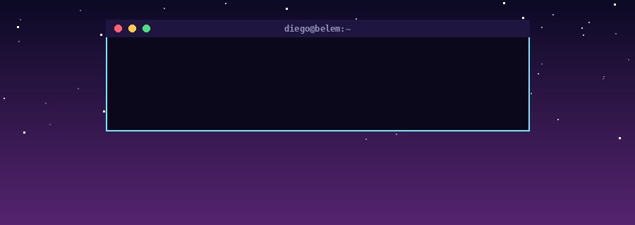
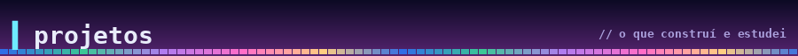
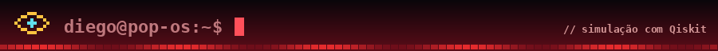
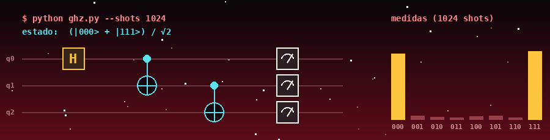
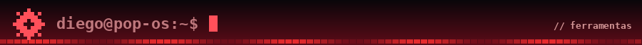
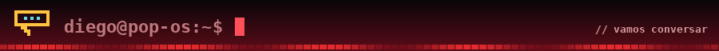
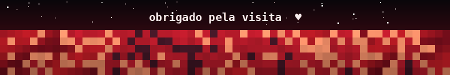

  

Estudante de Engenharia da Computação em Belém, com formação técnica em TI.
Gosto de Flutter, APIs REST, jogos e Linux (Pop!_OS), e estou aprendendo computação quântica com Qiskit.

- **[wfc-bench](https://github.com/Dio-zic/wfc-bench)**: geração procedural de mapas, clássica e quântica, em simulador.
- **[qkd-qrng](https://github.com/Dio-zic/qkd-qrng)**: simulações do BB84 (chaves quânticas) e de um gerador quântico de números aleatórios.

  

Ilustração de um circuito GHZ (H + CNOT), do tipo que simulo em Qiskit. As barras são ilustrativas, não dados de um experimento.

  
  
  
  
  
  
  
  
  

  
  

